  

I build backend systems where money moves: payments, trading and AI integration, designed and shipped end to end on my own. The terminal above runs on live market and macro data and updates itself every six hours.

### Featured

**[CryptoPay](https://github.com/Behruz44/CryptoPay-case-public)**: blockchain payment platform that accepts crypto payments and settles them to merchants in local currency. 14 backend services and a mobile app, built solo, around 120 automated tests.
### Stack

  
  

